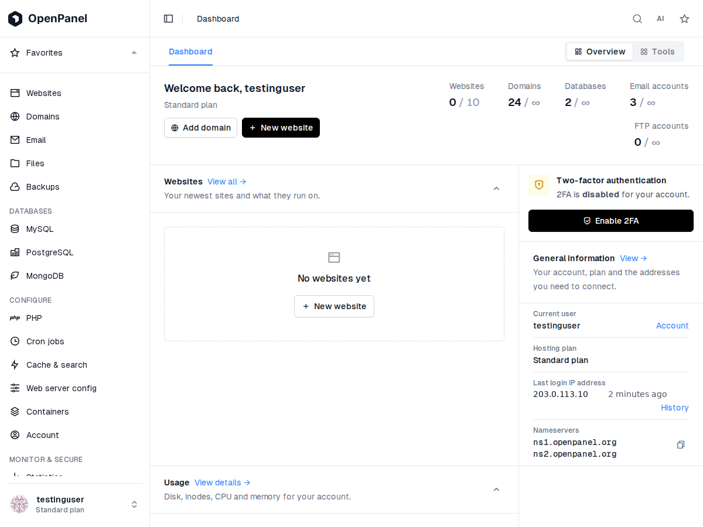

# bootstrap-openpanel-theme

Starter theme for the OpenPanel 2.x user panel. It holds the same templates that are built into OpenPanel, so it looks exactly like the default panel. Fork or copy it and change only what you need.



## Use it

```bash
git clone https://github.com/stefanpejcic/bootstrap-openpanel-theme /etc/openpanel/openpanel/templates/mytheme
```

Then pick **mytheme** in **OpenAdmin > Settings > OpenPanel > Theme**, or run:

```bash
opencli config update template mytheme
```

## What's inside

- `readme.txt`: theme name, version, author and license, shown on the theme card in OpenAdmin. Required, edit it first.
- `screenshot.png`: the theme card image, 1200×900 works well.
- `base.html`, `partials/`, `user/`, `domains/`, ...: the panel's templates in Go [html/template](https://pkg.go.dev/html/template) syntax, same layout as `openpanel/internal/web/templates/` in the [OpenPanel repository](https://github.com/stefanpejcic/OpenPanel).

You can delete every file you don't change: OpenPanel takes missing files from its built-in templates, which also keeps your theme up to date with panel updates. A theme can be as small as `readme.txt` plus one restyled `base.html`.

Extras a theme can have:

- `partials/*.html` that the panel doesn't have are added to every page.
- `static/` replaces the panel's `/static/` files with the same path, e.g. `static/css/theme.css` is served as `/static/css/theme.css` (load it with `{{static "css/theme.css"}}`).

If a page fails to render, OpenPanel shows its built-in version and logs why: `podman logs openpanel 2>&1 | grep "theme "`.

## Share your theme

Package the theme (`tar czf mytheme.tar.gz mytheme/`) and open a pull request adding it to `openpanel/templates/themes.yml` in [openpanel-configuration](https://github.com/stefanpejcic/openpanel-configuration), so it shows up under **Available themes** in every OpenAdmin. Full guide: [How to create and install themes](https://openpanel.com/docs/articles/dev-experience/openpanel-themes/).
